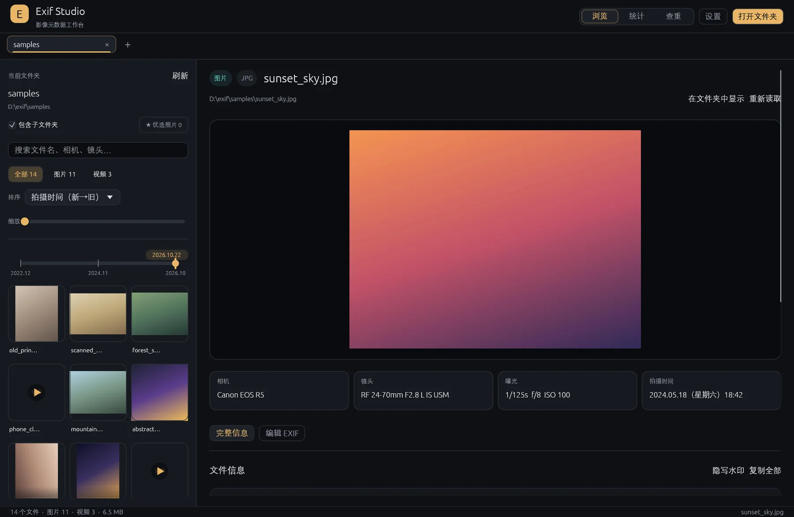

# Exif Studio

[简体中文](README.md) | English

[Project page](https://for404cat.github.io/exif-studio/) · [GitHub](https://github.com/for404cat/exif-studio)

A local-first metadata workbench for photos and videos, built with Rust and `egui`. It reads ordinary folders and SMB/UNC shares directly, with no database, WebView, or cloud service. Scanning, thumbnails, duplicate detection and watermarking all run on the machine.

Current version: `0.1.0`. Windows is the primary development and test platform; macOS and Linux share the same code with platform-specific adapters.

[](https://for404cat.github.io/exif-studio/index.en.html)

## Features

### Browsing and search

- Multiple folder tabs, each keeping its own filters, selection, statistics and unsaved edits.
- Recursive scanning and a virtualized thumbnail grid with continuous zoom. Only visible rows request thumbnails.
- Search by filename, camera or lens; filter by images/videos, subfolder or favorites.
- Sort photos by filename, capture time or resolution. Time sorting adds a clickable/draggable timeline that jumps to a period.
- Subfolder groups are shown as chips. Two rows by default; the expanded list is height-limited and virtualized, so the photo grid keeps its space.
- Opening a video in an external player always asks for confirmation first.

### Metadata

- Read camera, lens, resolution, capture time, exposure, aperture, shutter speed, focal length, ISO and GPS.
- Full EXIF groups, collapsible summaries and a raw-tag toggle.
- Edit description, artist, copyright, software, body, lens, capture time, exposure, orientation and GPS. A `.bak` backup is created by default.
- Damaged, truncated or unsupported images show a short message; the original technical error stays in a hover tooltip.

### Duplicate detection

- Local dHash perceptual hashing plus brightness, sharpness, contrast and resolution quality scoring.
- Similar photos are grouped automatically, with the best-looking frame in each group marked.
- Paged view (20 groups per page) and waterfall view; `PageUp`/`PageDown` and mouse side buttons work for paging.
- Sort by duplicate count, time or resolution. Under time sorting, the scroll position becomes a jumpable timeline.
- Fingerprints are computed on 4–16 CPU threads. The GPU only renders the interface.

### Statistics and watermarking

- File counts and sizes, format/brand/model/lens/resolution distributions, year/month charts, exposure distributions, GPS points and location clusters.
- Generate an LSB watermark in a PNG copy without modifying the original. Supports passphrase scrambling and local extraction.
- A local visual index handles screenshots, scaling and second-generation JPEG compression. LSB is not encryption.

### Local API

Disabled by default. When enabled, it listens only on `127.0.0.1`, requires a Bearer token, is read-only, and returns metadata only for already-opened folders. See [docs/API.en.md](docs/API.en.md).

## Supported formats

| Capability | Formats |
| --- | --- |
| Scan and list | JPEG, PNG, TIFF, WebP, HEIC/HEIF/HIF, AVIF, JXL; MP4, M4V, MOV, 3GP, 3G2 |
| EXIF read | JPEG and TIFF; PNG/WebP/HEIC/AVIF/JXL depend on `little_exif` container support and are treated as unsupported when parsing fails |
| Thumbnails/preview | JPEG, PNG, TIFF, WebP, BMP, GIF |
| EXIF write | JPEG, PNG, TIFF, WebP, HEIC/HEIF/HIF, AVIF, JXL; actual writing depends on `little_exif` container support and failures are reported |
| Duplicate detection | JPEG, PNG, TIFF, WebP, BMP, GIF |
| Invisible watermark | Always writes a PNG copy; decodable JPEG, PNG, TIFF, WebP, BMP or GIF input |
| Video metadata | MP4, M4V, MOV, 3GP, 3G2; H.264/H.265 codec names, other FourCCs shown verbatim |
| RAW | Not supported |

Video metadata is always read-only. HEIC/AVIF/JXL have no built-in decode preview.

## Build and run

Rust stable is required (edition 2024, at least 1.85) plus a working graphical environment.

```bash
cargo run --release
cargo run --release -- "D:\\Photos"
cargo run --release -- "D:\\Photos" --stats
```

Build output:

```bash
cargo build --release
# Windows: target/release/exif-studio.exe
# macOS / Linux: target/release/exif-studio
```

Linux needs the usual X11/Wayland desktop dependencies and a CJK font (Noto Sans CJK, WenQuanYi, etc.). The folder picker uses XDG Desktop Portal or the desktop environment's native picker.

Generate test media:

```bash
cargo run --example make_samples
# Writes to ./samples by default; the folder is ignored by git
```

Checks:

```bash
cargo fmt --check
cargo clippy --all-targets -- -D warnings
cargo test --all-targets
```

## Keyboard shortcuts

| Shortcut | Action |
| --- | --- |
| `Ctrl+1/2/3` | Browse / Statistics / Duplicates |
| `Ctrl+O` | Open folder |
| `Ctrl+W` | Close current tab |
| `Ctrl+Tab` | Next tab |
| `F5` | Rescan |
| `Ctrl+S` | Save EXIF edits |
| `PageUp/PageDown` | Duplicate pages |

## Configuration and cache

| Content | Windows | macOS | Linux |
| --- | --- | --- | --- |
| Settings, ratings, watermark index | `%APPDATA%\exif-studio` | `~/Library/Application Support/exif-studio` | `~/.config/exif-studio` |
| Default cache | `%LOCALAPPDATA%\exif-studio` | `~/Library/Caches/exif-studio` | `~/.cache/exif-studio` |

Cache layout:

```text
exif-studio/
├── metadata.json          # file metadata, invalidated by size/mtime
├── vision.json            # perceptual hashes and quality scores
└── thumbs/                # thumbnails/previews, sharded by hash
```

The cache location, limit and cleanup are available in Settings. Files on disk are the only source of truth; deleting the cache only causes a re-read.

## Code layout

```text
src/
├── main.rs        # entry point, window and wgpu setup
├── app.rs         # tabs, views, interaction and polling
├── model.rs       # media entries, formats and formatting
├── scan.rs        # streaming discovery + parallel metadata reads
├── details.rs     # background full-EXIF details
├── exif_io.rs     # EXIF read/write, grouping, embedded thumbnails
├── video.rs       # MP4/MOV container parser
├── video_poster.rs
├── vision.rs      # dHash, quality scoring, clustering, fingerprint cache
├── watermark.rs   # LSB watermark and visual index
├── stats.rs
├── cache.rs       # thumbnail disk cache
├── metacache.rs   # metadata cache
├── catalog.rs     # ratings
├── settings.rs
├── api.rs
├── platform.rs
└── widgets.rs
```

`site/` contains the GitHub Pages landing page; `docs/` contains architecture, development and API documentation.

See [docs/ARCHITECTURE.en.md](docs/ARCHITECTURE.en.md) for the scan pipeline, caches, threading model, state invariants and performance constraints.

## Documentation

- [Architecture and internals](docs/ARCHITECTURE.en.md): data flow, threads, caches, algorithms and change constraints.
- [Development and maintenance](docs/DEVELOPMENT.en.md): debugging, adding formats/fields/views/API, release checks.
- [Local API](docs/API.en.md): endpoints, parameters, response shapes and security boundaries.
- [Contributing](CONTRIBUTING.en.md)
- [Security](SECURITY.en.md)

## Known limitations

- dHash detects near-duplicates such as bursts, copies and small crops. It is not semantic search.
- Video is read-only; Linux/macOS posters rely on system tools or external programs (Quick Look, ffmpeg).
- The LSB watermark is not robust against strong lossy processing, and the passphrase is not encryption.
- The UI is currently Chinese only; localization is not implemented yet.
- The local API is a read-only snapshot refreshed at most once per second. It does not expose thumbnails or full EXIF groups.
- Low GPU usage during duplicate detection is expected: dHash and quality scoring run on the CPU.

## License

MIT. See [LICENSE](LICENSE).
