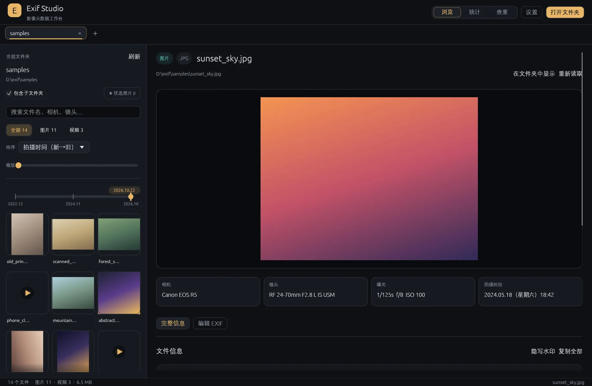

# Exif Studio

简体中文 | [English](README.en.md)

[项目主页](https://for404cat.github.io/exif-studio/) · [GitHub](https://github.com/for404cat/exif-studio)

本地运行的照片/视频元数据工作台，使用 Rust 和 `egui` 原生绘制。它直接读取普通目录或 SMB/UNC 共享，不依赖数据库、WebView 或云服务；扫描、缩略图、查重、水印都在本机完成。

当前版本 `0.1.0`，Windows 是主要开发和测试平台，macOS/Linux 共用同一套代码并保留平台适配。

[](https://for404cat.github.io/exif-studio/)

## 功能

### 浏览与检索

- 多文件夹标签页，递归扫描，保留每个标签页的筛选、选中项、统计和未保存编辑。
- 缩略图网格虚拟滚动，支持连续缩放；只加载可见行的缩略图。
- 按文件名、相机、镜头搜索；按图片/视频、子目录、优选状态筛选。
- 照片按文件名、拍摄时间或分辨率排序。时间排序时提供可点击/拖动的时间轴，直接跳到对应时间段。
- 子目录分组显示为标签，默认两行；展开后限高虚拟滚动，不会把照片网格挤出视野。
- 视频先弹出“将在外部应用打开”的确认，再交给系统播放器。

### 元数据

- 读取相机、镜头、分辨率、拍摄时间、曝光、光圈、快门、焦距、ISO、GPS 等字段。
- 完整 EXIF 分组展示，支持折叠摘要和原始标签开关。
- 编辑描述、作者、版权、软件、机身、镜头、拍摄时间、曝光参数、方向、GPS；默认写入前生成 `.bak` 备份。
- 损坏、截断或不支持的图片显示简短提示，原始技术错误放在悬停提示里，不直接铺在界面上。

### 查重

- 本地 dHash 感知哈希 + 亮度/锐度/对比度/分辨率画质评分。
- 相似照片自动分组，并为每组标出画质最佳的一张。
- 分页（每页 20 组）和瀑布流两种布局；支持 `PageUp`/`PageDown` 和鼠标侧键翻页。
- 可按重复数量、时间或分辨率排序；时间排序下滚动位置会变成时间轴。
- 指纹由 4–16 个 CPU 线程计算，GPU 只负责界面渲染。

### 统计与水印

- 文件数量/体积、格式/品牌/型号/镜头/分辨率分布、年份月份、曝光参数、GPS 散点和位置聚类。
- 为图片生成 LSB 隐写水印的 PNG 副本，不修改原图；支持口令打散和本机识别。
- 水印索引支持截图、缩放和二次 JPEG 压缩后的本机视觉匹配。LSB 不是加密。

### 本地 API

默认关闭。启用后只在 `127.0.0.1` 监听，只读、Bearer Token 鉴权、只返回已打开目录中的元数据。接口和威胁模型见 [docs/API.md](docs/API.md)。

## 支持格式

| 能力 | 格式 |
| --- | --- |
| 扫描与列表 | JPEG、PNG、TIFF、WebP、HEIC/HEIF/HIF、AVIF、JXL；MP4、M4V、MOV、3GP、3G2 |
| EXIF 读取 | JPEG、TIFF；PNG/WebP/HEIC/AVIF/JXL 依赖 `little_exif` 容器支持，失败时按不支持处理 |
| 缩略图/预览 | JPEG、PNG、TIFF、WebP、BMP、GIF |
| EXIF 写入 | JPEG、PNG、TIFF、WebP、HEIC/HEIF/HIF、AVIF、JXL；实际写入能力取决于 `little_exif` 的容器支持，失败会明确报错 |
| 查重 | JPEG、PNG、TIFF、WebP、BMP、GIF |
| 隐写水印 | 写入始终输出 8-bit PNG；输入为可解码的 JPEG、PNG、TIFF、WebP、BMP、GIF |
| 视频元数据 | MP4、M4V、MOV、3GP、3G2；H.264/H.265 显示编码名称，其他 FourCC 原样显示 |
| RAW | 暂不支持 |

视频元数据始终只读。HEIC/AVIF/JXL 目前没有内置解码预览。

## 构建与运行

要求 Rust stable（edition 2024，最低 1.85）和可用的图形环境。

```bash
cargo run --release
cargo run --release -- "D:\\Photos"
cargo run --release -- "D:\\Photos" --stats
```

构建产物：

```bash
cargo build --release
# Windows: target/release/exif-studio.exe
# macOS / Linux: target/release/exif-studio
```

Linux 需要常见的 X11/Wayland 桌面依赖和中文字体（Noto Sans CJK、文泉驿等）。文件选择器使用 XDG Desktop Portal 或桌面环境提供的目录选择能力。

生成测试素材：

```bash
cargo run --example make_samples
# 默认写入 ./samples，不提交到仓库
```

质量检查：

```bash
cargo fmt --check
cargo clippy --all-targets -- -D warnings
cargo test --all-targets
```

## 快捷键

| 快捷键 | 作用 |
| --- | --- |
| `Ctrl+1/2/3` | 浏览 / 统计 / 查重 |
| `Ctrl+O` | 打开文件夹 |
| `Ctrl+W` | 关闭当前标签页 |
| `Ctrl+Tab` | 下一个标签页 |
| `F5` | 重新扫描 |
| `Ctrl+S` | 保存 EXIF 编辑 |
| `PageUp/PageDown` | 查重分页 |

## 配置与缓存

| 内容 | Windows | macOS | Linux |
| --- | --- | --- | --- |
| 配置、星标、水印索引 | `%APPDATA%\exif-studio` | `~/Library/Application Support/exif-studio` | `~/.config/exif-studio` |
| 默认缓存 | `%LOCALAPPDATA%\exif-studio` | `~/Library/Caches/exif-studio` | `~/.cache/exif-studio` |

缓存目录：

```text
exif-studio/
├── metadata.json          # 文件元数据，按大小/修改时间失效
├── vision.json            # 感知哈希与画质评分
└── thumbs/                # 缩略图/预览，按哈希分片
```

缓存可以在设置中修改位置、上限或清理。目录中的照片是唯一数据源，删除缓存只会触发重新扫描和解码。

## 代码结构

```text
src/
├── main.rs        # 入口、窗口、wgpu 初始化
├── app.rs         # 标签页、视图、交互、轮询调度
├── model.rs       # 媒体条目、格式与格式化
├── scan.rs        # 流式发现 + 并行元数据读取
├── details.rs     # 后台完整 EXIF 详情
├── exif_io.rs     # EXIF 读写、分组、缩略图提取
├── video.rs       # MP4/MOV 容器解析
├── video_poster.rs
├── vision.rs      # dHash、画质评分、聚类、指纹缓存
├── watermark.rs   # LSB 水印与视觉索引
├── stats.rs
├── cache.rs       # 缩略图磁盘缓存
├── metacache.rs   # 元数据缓存
├── catalog.rs     # 星标
├── settings.rs
├── api.rs
├── platform.rs
└── widgets.rs
```

`site/` 是 GitHub Pages 主页，`docs/` 存放架构、开发和 API 文档。

扫描、缓存、线程模型、状态不变量和性能约束见 [docs/ARCHITECTURE.md](docs/ARCHITECTURE.md)。

## 文档

- [架构与实现](docs/ARCHITECTURE.md)：数据流、线程、缓存、算法和改动约束。
- [开发与维护](docs/DEVELOPMENT.md)：构建调试、扩展格式/字段/视图/API 的步骤、发布检查。
- [本地 API](docs/API.md)：端点、参数、返回结构和安全边界。
- [贡献指南](CONTRIBUTING.md)
- [安全说明](SECURITY.md)

## 已知限制

- dHash 只能识别连拍、副本、轻微裁剪等近似重复，不是语义搜索。
- 视频只读；Linux/macOS 封面依赖系统或外部工具（Quick Look、ffmpeg）。
- LSB 水印不抗强有损处理，口令不是加密。
- 界面目前只有中文，多语言尚未实现。
- 本地 API 是只读快照，最多每秒刷新一次，不提供缩略图和完整 EXIF 分组。
- 查重时 GPU 占用低是正常的：dHash 和画质评分在 CPU 上计算。

## 许可证

MIT，见 [LICENSE](LICENSE)。
